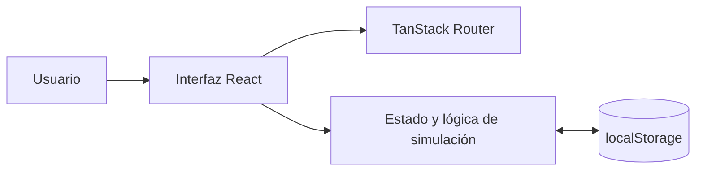

# HomeClimate+

**Prototipo web de gestión domótica y simulación de climatización.**

HomeClimate+ es una aplicación *frontend* para modelar un hogar, organizar habitaciones, registrar dispositivos virtuales y explorar controles de climatización desde una interfaz responsive. Permite experimentar con escenas, horarios, reglas y estimaciones de consumo sin necesitar equipos físicos.

> **Estado del proyecto:** prototipo funcional a nivel de interfaz, con lógica simulada y almacenamiento en el navegador. **No controla dispositivos IoT reales, no dispone de servidor ni proporciona autenticación segura.** No debe utilizarse como plataforma de control doméstico en producción.

## Funcionalidades

### Hogar y dispositivos

- Registro e inicio de sesión **de demostración**, gestionados únicamente en el navegador.
- Asistente de configuración inicial del hogar y sus habitaciones.
- Alta y consulta de dispositivos virtuales: **aires acondicionados, luces y enchufes**.
- Búsqueda y filtrado de dispositivos por nombre, tipo y habitación.
- Vista de detalle con controles específicos para cada tipo de dispositivo.
- Organización por habitaciones y selección de dispositivos favoritos.

### Climatización simulada

- Encendido/apagado virtual de aires acondicionados, ajuste de temperatura y selección de modo.
- Escenas predefinidas y personalizadas para aplicar configuraciones al simulador.
- Creación y edición de horarios, **sin ejecución automática en segundo plano**.
- Geocerca de demostración con botones para simular entrar o salir del hogar; **no accede al GPS**.
- Indicadores de consumo y CO₂ calculados a partir de estados simulados; **no son lecturas de sensores**.
- Estimador ilustrativo de ahorro energético y recordatorios de mantenimiento en la interfaz; **no constituye un cálculo energético validado**.

### Automatizaciones y ajustes

- Editor de reglas con disparadores manuales, horarios, geocerca y sensores.
- Creación, edición, activación/desactivación y eliminación de reglas en `localStorage`.
- Las reglas **no cuentan con un motor de ejecución**: no se disparan por tiempo, geolocalización o sensores reales.
- Gestión visual de favoritos y registro local de invitaciones; **no se envían correos ni se habilita colaboración real**.

## Tecnologías

| Capa | Tecnología |
| --- | --- |
| Interfaz | React 19, TypeScript |
| Desarrollo y compilación | Vite 7, plugin React SWC |
| Navegación | TanStack React Router |
| Estilos | CSS, Tailwind CSS / PostCSS |
| Persistencia | `localStorage` del navegador |
| Calidad estática | TypeScript, ESLint |

No se utilizan API REST, base de datos, servidor de autenticación ni protocolos de comunicación IoT en la versión incluida en este repositorio.

## Arquitectura



El estado de la aplicación se conserva **en el navegador y origen actuales**. No se sincroniza entre navegadores, dispositivos ni cuentas reales. Limpiar los datos del sitio puede eliminar toda la configuración guardada.

## Requisitos

- Node.js compatible con Vite 7 (se recomienda Node.js 22 LTS).
- npm.
- Navegador moderno con soporte de almacenamiento local.

## Instalación y ejecución

```bash
git clone https://github.com/MrNano08/HomeClimatePlus.git
cd HomeClimatePlus
npm ci
npm run dev
```

Abre la dirección local que indique Vite, normalmente `http://localhost:5173`.

**Importante:** en la copia revisada existe una importación incorrecta en `src/Components/HomeControl/ControlPanel.tsx`: usa `./Hometypes`, pero el archivo existente se llama `home.types.ts`. Hay que corregir la ruta de importación a `./home.types` para poder compilar el proyecto. La ejecución integral todavía no se ha verificado.

### Otros comandos

```bash
npm run build    # Comprueba TypeScript y genera dist/
npm run preview  # Previsualiza la compilación local
npm run lint     # Ejecuta ESLint
```

El repositorio incluye `package-lock.json`, pero **no contiene una suite de pruebas automatizadas ni un script `npm test`**. No se afirma que los comandos de compilación o lint superen sus comprobaciones hasta ejecutarlos con las dependencias instaladas.

## Recorrido de demostración

1. Abre la aplicación y crea una **cuenta ficticia**. No utilices credenciales reales.
2. Completa el asistente de configuración del hogar y define habitaciones.
3. Agrega un aire acondicionado, una luz o un enchufe virtual.
4. Abre **Dispositivos** para filtrar, seleccionar y cambiar estados.
5. En **Inicio**, selecciona un aire acondicionado y prueba las escenas, la simulación de geocerca, el simulador y la configuración de horarios.
6. Visita **Automatizaciones** y crea una regla. Puedes guardarla y editarla, pero no se ejecutará automáticamente.
7. Consulta **Ajustes** para marcar favoritos y registrar invitaciones locales de demostración.

## Estructura principal

```text
src/
├── Components/
│   ├── Automations/       # Editor visual de reglas
│   ├── Common/            # Componentes reutilizables
│   └── HomeControl/       # Controles, escenas, horarios y simulación
├── Pages/
│   ├── Automations/       # Administración de reglas
│   ├── Devices/           # Dispositivos y vistas de detalle
│   ├── Home/              # Panel de climatización
│   ├── Onboarding/        # Configuración inicial
│   ├── Rooms/             # Organización por habitaciones
│   └── Settings/          # Favoritos e invitaciones locales
├── hooks/                 # Hook de almacenamiento local
├── router/                # Rutas y comprobaciones de sesión de demo
├── store/                 # Lectura y escritura de localStorage
└── types/                 # Tipos de hogar, dispositivo y reglas
```

## Seguridad y limitaciones

Este proyecto es una **demostración académica/técnica**, no una solución de producción.

- El registro guarda correos y **contraseñas en texto plano en `localStorage`**. El inicio de sesión compara esos valores en el navegador. **No se deben usar contraseñas personales, reales o reutilizadas.**
- Las comprobaciones de rutas y sesión se ejecutan en el cliente; no constituyen controles de acceso seguros.
- Los datos del hogar y los dispositivos utilizan claves compartidas dentro del mismo origen del navegador; no existe aislamiento efectivo entre usuarios.
- Las supuestas invitaciones a otros miembros son registros locales y no envían mensajes.
- Las mediciones, la geocerca, los dispositivos y el cálculo de ahorro son simulados; no hay integración con sensores, hardware ni servicios externos.
- Los horarios y las reglas pueden editarse, pero no hay un proceso que los ejecute automáticamente.
- No hay pruebas automatizadas ni resultados de validación funcional reproducibles en el repositorio revisado.

Para evolucionarlo hacia una aplicación real serían necesarios, como mínimo, autenticación y persistencia de servidor, aislamiento de datos, integración IoT y pruebas automatizadas.

## Mejoras previstas / sugeridas

- [ ] Corregir la importación `./Hometypes` para recuperar la compilación.
- [ ] Reemplazar la autenticación simulada por autenticación segura con backend (o retirarla de una demo pública).
- [ ] Añadir pruebas unitarias y de interfaz.
- [ ] Implementar el motor que ejecute horarios y automatizaciones, si el alcance lo requiere.
- [ ] Conectar dispositivos y sensores mediante protocolos o servicios apropiados, si se decide evolucionar de prototipo a IoT.
- [ ] Incorporar capturas de pantalla reales y una demostración grabada.

## Autor

Desarrollado por [MrNano08](https://github.com/MrNano08).

## Licencia

La copia revisada no incluye un archivo `LICENSE`. Si se pretende permitir la reutilización del código, es necesario elegir y agregar una licencia explícita.
